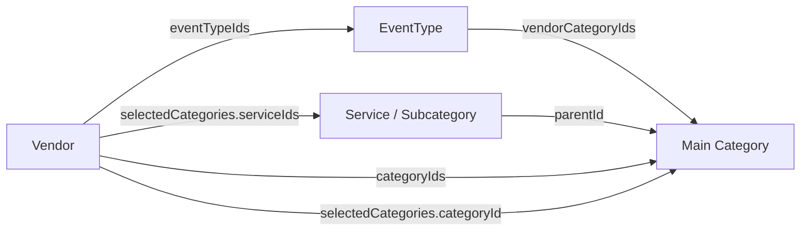

# Taxonomy and Seed Implementation Review

The seed defines 19 main vendor categories, 288 services/subcategories, and 29 event types. All event types have category mappings. The 19 pending event types are retained with proposed mappings and inactive seed defaults until review and verification are complete.

## Requested Category Groupings

| Main category | Subcategories/services |
| --- | --- |
| Rangoli Artists | Separate main category with traditional, floral, wedding, festival, and corporate rangoli services |
| Event Planners | Corporate Event Planners and Conference Event Planners, plus event planning specialties listed below |
| Photography & Videography | Separate Photographers and Videographers child records; existing photography/video specialty service records are retained |
| Production & Technical Setup | Stage Setup; Sound & Lighting; LED Wall & Screen Rentals |

Corporate Event Vendors is a generic label and is not assigned to Event Planners. Classify the actual service: for example, Corporate Caterers belongs to Caterers, a hotel or conference hall belongs to Venues, and Stage Setup belongs to Production & Technical Setup. Only actual planning services belong to Event Planners.

Existing DJs, entertainment, venue, and decorative service categories remain part of the taxonomy. Stage Decorators and Lighting Decorators are decorative services; production equipment and technical setup have a separate main category.

## Complete Vendor Taxonomy

Services and subcategories use the existing two-level Category model. A main Category has `parentId: null`; every service/subcategory has `parentId` pointing directly to its main Category. Photographers and Videographers are separate child records under Photography & Videography. Existing specialty services remain alongside them so their IDs and vendor selections do not require reparenting.

| Main vendor category | Child records | Services/subcategories |
| --- | --- | --- |
| Venues | 15 | Wedding Hall; Birthday Hall; Kalyan Mandaps; Destination Wedding; Function & Party Halls; Restaurant & Cafe; Hotels; Resorts; Banquet Halls; Farmhouses & Villas; Rooftop Venues; Palace & Heritage Venues; Conference & Meeting Halls; Community Halls; Corporate Venues |
| Decorators | 21 | Griha Pravesh; Wedding Decorators; Floral Decorators; Balloon Decorators; Stage Decorators; Theme Decorators; Luxury Decorators; Traditional Decorators; Modern & Minimalist Decorators; Mandap Decorators; Entrance & Welcome Gate Decorators; Lighting Decorators; Ceiling Decorators; Home Decorators; Corporate Decorators; Outdoor Event Decorators; Tent & Canopy Decorators; Photo Booth & Backdrop Decorators; Car Decorators; Event Concept & Design; Funny Signages |
| Caterers | 18 | Wedding Caterers; Vegetarian Caterers; Non-Vegetarian Caterers; Outdoor Catering; Indoor Catering; Corporate Caterers; Birthday Party Caterers; Maharashtrian Caterers; Punjabi Caterers; Rajasthani Caterers; Gujarati Caterers; Bengali Caterers; Italian Food Caterers; South Indian; North Indian/Mughlai; Chaat & Food Stalls; Jain Food Caterers; Continental (Thai / Italian / Chinese) |
| Makeup Artists | 17 | Bridal Makeup Artists; Family Makeup; Party Makeup; Wedz Makeup; HD Makeup Artists; Engagement Makeup; Celebrity Makeup Artists; Hairstylists; Pre-Wedding Makeup; Maternity Makeup; Fashion & Editorial Makeup; Photoshoot Makeup; Groom Makeup Artists; Haldi Makeup Artists; Traditional Makeup Artists; Fashion & Editorial Makeup Artists; Baby Shower Makeup Artists |
| Photography & Videography | 19 | Wedding Photography; Pre-Wedding Shoot; Post-Wedding Shoot; Cinematic Video; Traditional Video; Traditional Photography; Drone Photography; Albums; Maternity Photoshoot; Newborn Photography; Birthday Photography; Couple Photoshoot; Fashion Photography; Corporate Event Photography; Baby Shower Photography; Candid Photography; Housewarming Photography; Photographers; Videographers |
| Mehndi Artists | 15 | Bridal Mehndi; Groom Mehndi; Maternity Mehndi; Side Mehndi; Traditional Mehndi; Back Hands Mehndi; Full Hands Mehndi; Arabic Mehndi; Engagement Mehndi; Rajasthani Mehndi; Marwari Mehndi; Portrait Mehndi; Dulha-Dulhan Mehndi; Festival Mehndi; Baby Shower Mehndi |
| DJs | 15 | Mini DJs; Banjo; Dhol Tasha Pathak; Lezim Pathak; Dhol Pathak; Live Percussionists; Nashik Dhol; Brass Orchestra; Punjabi Dhol; Ghodi & Band Services; Traditional Dhol; Traditional Music Groups; Club DJ; Live Instrumental Groups; Karaoke DJs |
| Jewellery on Rent | 14 | Couple Jewellery Sets; Groom Jewellery; Engagement Jewellery; Reception Jewellery; Bridal Jewellery; Punjabi Jewellery; Wedding Jewellery; Rajasthani Jewellery; Maharashtrian Jewellery; Floral Jewellery; Haldi Jewellery Sets; Maternity Jewellery; Traditional Jewellery; Festival Jewellery |
| Invitation Cards / Designers | 22 | Digital Wedding Invitations; Wedding Invitation Cards; E-Invitations; Animated Video Invitations; Luxury Wedding Invitations; Premium Invitation Cards; Traditional Invitation Cards; Modern Invitation Cards; Video Invitations; Personalized Invitation Cards; Engagement Invitation Cards; Haldi Invitation Cards; Mehndi Invitation Cards; Sangeet Invitation Cards; Reception Invitation Cards; Birthday Invitation Cards; Baby Shower Invitations; Naming Ceremony Invitations; Anniversary Invitation Cards; Corporate Event Invitations; Party Invitations; Photo Invitation Cards |
| Choreographers | 22 | Wedding Choreographers; Sangeet Choreographers; Couple Dance Choreographers; Bride Solo Dance; Groom Solo Dance; Bride & Groom Couple Dance; Family Dance Choreographers; Friends Group Dance; Haldi Dance Choreographers; Mehndi Dance Choreographers; Engagement Dance Choreographers; Reception Dance Choreographers; Bollywood Dance Choreographers; Classical Dance Choreographers; Hip-Hop Dance Choreographers; Birthday Party Choreographers; Kids Dance Choreographers; Professional Dance Groups; Garba Groups; Home Dance Training; Celebrity Dance Trainers; Wedding Entry Dance |
| Groom Wear | 8 | Wedding Sherwani; Indo-Western Outfits; Wedding Suits & Tuxedos; Groom Wear on Rent; Haldi & Mehndi Outfits; Designer Turbans & Safas; Custom-Tailored Groom Wear; Groom Accessories |
| Bridal Wear | 21 | Bridal Lehenga; Traditional Bridal Wear; Designer Lehenga; Royal Bridal Wear; Wedding Sarees; Maharashtrian Bridal Wear; Designer Sarees; Rajasthani Bridal Wear; Bridal Gowns; South Indian Bridal Wear; Wedding Dresses; Muslim Bridal Wear; Reception Gowns; Jain Bridal Wear; Engagement Outfits; Bridal Dupatta; Haldi Outfits; Mehndi Outfits; Sangeet Outfits; Cocktail Party Dresses; Pre-Wedding Outfit |
| Honeymoon | 21 | Domestic Honeymoon Packages; Anniversary Travel Packages; International Honeymoon Packages; Luxury Honeymoon Packages; Budget Honeymoon Packages; Weekend Getaway Packages; Romantic Honeymoon Packages; Cultural Honeymoon Tours; Adventure Honeymoon Packages; Wildlife & Nature Honeymoon; Beach Honeymoon Packages; Cruise Honeymoon Packages; Hill Station Honeymoon Packages; Destination Wedding & Honeymoon; Island Honeymoon Packages; Road Trip Honeymoon; Private Villa Honeymoon; Couple Tour Packages; Resort Honeymoon Packages; Customized Honeymoon Packages; All-Inclusive Honeymoon Packages |
| Gifts | 27 | Reception Gifts; Wedding Gifts; Anniversary Gifts; Bridal Gifts; Birthday Gifts; Groom Gifts; Flower & Bouquet Gifts; Couple Gifts; Return Gift Suppliers; Personalized Gifts; Wellness & Spa Hampers; Customized Gifts; Luxury Gifts; Engagement Gifts; Premium Gift Hampers; Corporate Gifts; Wedding Return Gifts; Family Gifts; Guest Welcome Hampers; Chocolates & Sweet Boxes; Bridesmaid Gifts; Groomsmen Gifts; Newborn Baby Gifts; Festival Gifts; Handmade Gifts; Photo Frames & Albums; Luxury Gift Hampers |
| Entertainment | 9 | Anchor; Singers & Dancers; Artist; Garba & Dandiya Groups; Special Shows & Attractions; Bhajan & Kirtan Groups; Live Bands & Singers; Anchors & Emcees; Entertainment Artists |
| Pandits | 9 | Ganesh Puja Pandits; Griha Pravesh Pandits; Lakshmi Puja Pandits; Wedding Pandits; Navgraha Puja Pandits; Vastu Shanti Pandits; Havan & Yagya Specialists; Office Opening Puja Pandits; Pitra Dosh Puja Specialists |
| Rangoli Artists | 5 | Traditional Rangoli; Floral Rangoli; Wedding Rangoli; Festival Rangoli; Corporate Rangoli |
| Event Planners | 7 | Corporate Event Planners; Conference Event Planners; Wedding Planners; Party Planners; Festival & Cultural Event Planners; Concert & Show Planners; Sports Event Planners |
| Production & Technical Setup | 3 | Stage Setup; Sound & Lighting; LED Wall & Screen Rentals |

## Event Type Mappings

The status below is the seed default for a new record. Pending mappings are proposed for review; populating mappings or passing structural validation does not activate an event. Normal re-seeding preserves each existing record's saved activation status.

| Event type | Seed default | Mapped main vendor categories |
| --- | --- | --- |
| Wedding | Active | Venues; Decorators; Caterers; Makeup Artists; Photography & Videography; Mehndi Artists; DJs; Jewellery on Rent; Invitation Cards / Designers; Choreographers; Groom Wear; Bridal Wear; Honeymoon; Gifts; Pandits; Rangoli Artists; Entertainment; Event Planners; Production & Technical Setup |
| Reception | Active | Venues; Decorators; Caterers; Makeup Artists; Photography & Videography; Mehndi Artists; DJs; Jewellery on Rent; Invitation Cards / Designers; Choreographers; Groom Wear; Bridal Wear; Gifts; Rangoli Artists; Entertainment; Event Planners; Production & Technical Setup |
| Engagement | Active | Venues; Decorators; Caterers; Makeup Artists; Photography & Videography; Mehndi Artists; DJs; Jewellery on Rent; Invitation Cards / Designers; Choreographers; Gifts; Pandits; Entertainment; Rangoli Artists; Event Planners; Production & Technical Setup |
| Anniversary | Active | Venues; Decorators; Caterers; Makeup Artists; Photography & Videography; Mehndi Artists; DJs; Gifts; Invitation Cards / Designers; Choreographers; Rangoli Artists; Entertainment; Event Planners; Production & Technical Setup |
| Sangeet Ceremony | Active | Venues; Decorators; Caterers; Makeup Artists; Photography & Videography; Mehndi Artists; DJs; Jewellery on Rent; Invitation Cards / Designers; Choreographers; Groom Wear; Bridal Wear; Entertainment; Event Planners; Production & Technical Setup |
| Naming Ceremony / Baby Shower | Active | Venues; Decorators; Caterers; Makeup Artists; Photography & Videography; Mehndi Artists; Rangoli Artists; Jewellery on Rent; Invitation Cards / Designers; Entertainment; Gifts; Pandits; Event Planners |
| Birthday | Active | Venues; Decorators; Caterers; DJs; Photography & Videography; Invitation Cards / Designers; Choreographers; Gifts; Entertainment; Makeup Artists; Event Planners; Production & Technical Setup |
| Housewarming / Griha Pravesh | Active | Decorators; Caterers; Makeup Artists; Photography & Videography; Mehndi Artists; Invitation Cards / Designers; Gifts; Pandits; Rangoli Artists; Entertainment; Event Planners |
| Corporate Events | Active | Event Planners; Venues; Decorators; Caterers; Photography & Videography; DJs; Entertainment; Production & Technical Setup; Invitation Cards / Designers; Gifts |
| Conferences & Seminars | Active | Event Planners; Venues; Decorators; Caterers; Photography & Videography; DJs; Entertainment; Production & Technical Setup; Invitation Cards / Designers; Gifts |
| Award Ceremonies | Inactive, pending verification | Event Planners; Venues; Decorators; Caterers; Makeup Artists; Photography & Videography; DJs; Entertainment; Choreographers; Production & Technical Setup; Invitation Cards / Designers; Gifts |
| College Festivals | Inactive, pending verification | Event Planners; Venues; Decorators; Caterers; Makeup Artists; Photography & Videography; DJs; Entertainment; Choreographers; Production & Technical Setup; Invitation Cards / Designers; Gifts |
| School Events | Inactive, pending verification | Event Planners; Venues; Decorators; Caterers; Photography & Videography; Entertainment; Choreographers; Production & Technical Setup; Invitation Cards / Designers; Gifts |
| Farewell Party | Inactive, pending verification | Event Planners; Venues; Decorators; Caterers; Makeup Artists; Photography & Videography; DJs; Entertainment; Choreographers; Production & Technical Setup; Invitation Cards / Designers; Gifts |
| Graduation Ceremony | Inactive, pending verification | Event Planners; Venues; Decorators; Caterers; Photography & Videography; Entertainment; Production & Technical Setup; Invitation Cards / Designers; Gifts |
| Bachelor Party | Inactive, pending verification | Event Planners; Venues; Decorators; Caterers; Photography & Videography; DJs; Entertainment; Production & Technical Setup; Invitation Cards / Designers |
| Reunion Party | Inactive, pending verification | Event Planners; Venues; Decorators; Caterers; Photography & Videography; DJs; Entertainment; Production & Technical Setup; Invitation Cards / Designers; Gifts |
| Cocktail Party | Inactive, pending verification | Event Planners; Venues; Decorators; Caterers; Makeup Artists; Photography & Videography; DJs; Entertainment; Production & Technical Setup; Invitation Cards / Designers |
| Private Parties | Inactive, pending verification | Event Planners; Venues; Decorators; Caterers; Makeup Artists; Photography & Videography; DJs; Entertainment; Production & Technical Setup; Invitation Cards / Designers; Gifts |
| Family Get-Together | Inactive, pending verification | Event Planners; Venues; Decorators; Caterers; Photography & Videography; DJs; Entertainment; Rangoli Artists; Invitation Cards / Designers; Gifts |
| Festival Celebrations | Inactive, pending verification | Event Planners; Venues; Decorators; Caterers; Makeup Artists; Photography & Videography; Mehndi Artists; DJs; Jewellery on Rent; Entertainment; Choreographers; Pandits; Rangoli Artists; Production & Technical Setup; Invitation Cards / Designers; Gifts |
| Religious Events | Inactive, pending verification | Event Planners; Venues; Decorators; Caterers; Photography & Videography; Entertainment; Pandits; Rangoli Artists; Production & Technical Setup; Invitation Cards / Designers; Gifts |
| Cultural Events | Inactive, pending verification | Event Planners; Venues; Decorators; Caterers; Makeup Artists; Photography & Videography; DJs; Entertainment; Choreographers; Rangoli Artists; Production & Technical Setup; Invitation Cards / Designers; Gifts |
| Concerts & Live Shows | Inactive, pending verification | Event Planners; Venues; Decorators; Caterers; Makeup Artists; Photography & Videography; DJs; Entertainment; Choreographers; Production & Technical Setup; Invitation Cards / Designers |
| Fashion Shows | Inactive, pending verification | Event Planners; Venues; Decorators; Caterers; Makeup Artists; Photography & Videography; DJs; Entertainment; Choreographers; Production & Technical Setup; Invitation Cards / Designers |
| Charity & Fundraising Events | Inactive, pending verification | Event Planners; Venues; Decorators; Caterers; Photography & Videography; DJs; Entertainment; Production & Technical Setup; Invitation Cards / Designers; Gifts |
| Sports Events | Inactive, pending verification | Event Planners; Venues; Decorators; Caterers; Photography & Videography; Entertainment; Production & Technical Setup; Invitation Cards / Designers; Gifts |
| Political Events | Inactive, pending verification | Event Planners; Venues; Decorators; Caterers; Photography & Videography; Entertainment; Production & Technical Setup; Invitation Cards / Designers |
| Community Events | Inactive, pending verification | Event Planners; Venues; Decorators; Caterers; Photography & Videography; DJs; Entertainment; Rangoli Artists; Production & Technical Setup; Invitation Cards / Designers; Gifts |

## Stored Relationships



Before writing, the seed validates that services have existing main-category parents, event mappings reference existing main categories, active events reference active main categories, and vendor category/service/event references resolve. A vendor's selected service must belong to that selection's main category. Historical references to inactive records remain valid and are retained.

## Seed Implementation

- [seedReferenceData.js](../scripts/seedReferenceData.js) defines the taxonomy, event mappings, pending activation defaults, name normalization, and static validation.
- [referenceDataSeed.js](../scripts/referenceDataSeed.js) builds and validates the database proposal, reuses IDs, applies changes inside a transaction, and records backups and verification results.
- [referenceDataSeed.test.js](../test/referenceDataSeed.test.js) checks mapping integrity, service parents, ID preservation, inactive settings, idempotence, and failure/recovery behavior.

Main categories are matched by their root slug. Child services are matched by `(parentId, slug)`, keeping IDs stable within each parent. Event types are matched by their slug. Existing names and seed sort order are synchronized; descriptions, unknown historical fields, and saved activation settings are preserved. Missing records are inserted and approved category mappings are added without removing existing mapping entries.

The declared legacy main slug `photographers` is renamed to `photography-and-videography` when the canonical main category is absent. The existing main ID is reused, so child service IDs, their parent IDs, vendor selections, and event references stay intact. If both main categories exist, the legacy record is reported for explicit reconciliation instead of an automatic merge.

The normal seed writes only `categories` and `eventtypes`. It does not delete records, remove mapping entries, rewrite vendor documents, or move services to another parent. Stale records require the existing explicit reconciliation process; referenced records cannot be deactivated. Existing technical services under another parent must be reviewed separately rather than silently moved along with vendor selections.

Existing inactive categories, services, and events stay inactive. If an active event references an inactive main category, validation stops the apply before writes rather than reactivating that category. After a pending event is reviewed and verified, update its seed default and make an explicit activation update to the existing EventType; changing the seed default alone does not change saved activation settings.

## Review and Validation

Review the category/service names and each pending event's proposed mappings above. Run static validation without a database connection:

```bash
npm run seed:reference -- --dry-run
npm test
```

To review changes against the intended database, use the existing read-only comparison mode:

```bash
npm run seed:reference -- --compare
```

The existing development-only `--apply --confirm-dev` process requires ready unique indexes and transaction support. It validates the entire proposal, saves and verifies a local backup, and verifies before and after commit. See the [README](../README.md#reference-data-seed) for apply and reconciliation details. Tests use a driver double; server-side transaction/index behavior needs an isolated development MongoDB deployment.
